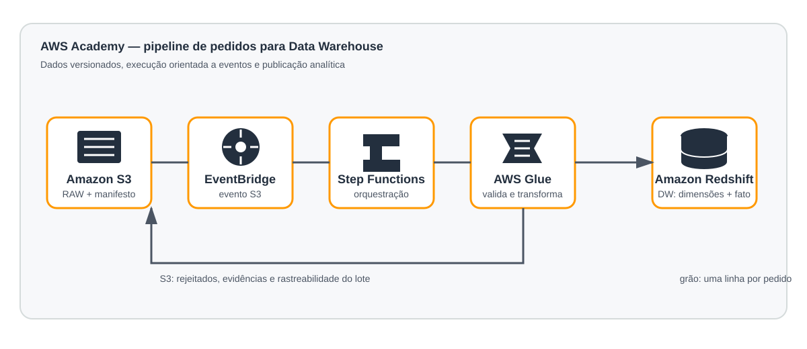

# Aula 23 — Data Warehouse na AWS Academy

Este repositório separa dados de entrada, código do pipeline e infraestrutura.

| Diretório | Conteúdo |
| --- | --- |
| `Aula23_Materiais/` | arquivos sintéticos e materiais de integração/Glue. |
| `warehouse/` | pipeline, SQL, envio de lotes, verificação e testes. |
| `terraform/` | infraestrutura como código organizada em módulos. |
| `docs/` | conceitos do modelo e fluxo de dados. |

Para validar a lógica sem criar recursos AWS:

```bash
python3 warehouse/test_pipeline.py
```

Consulte [docs/CONCEITOS_WAREHOUSE.md](docs/CONCEITOS_WAREHOUSE.md) e o
[guia do Terraform](terraform/README.md) antes do deploy.

## Arquitetura implantada



O diagrama representa os serviços efetivamente usados no laboratório: Amazon
S3, EventBridge, Step Functions, AWS Glue e Amazon Redshift. O catálogo Glue e
a `LabRole` existem como componentes de suporte à execução.
